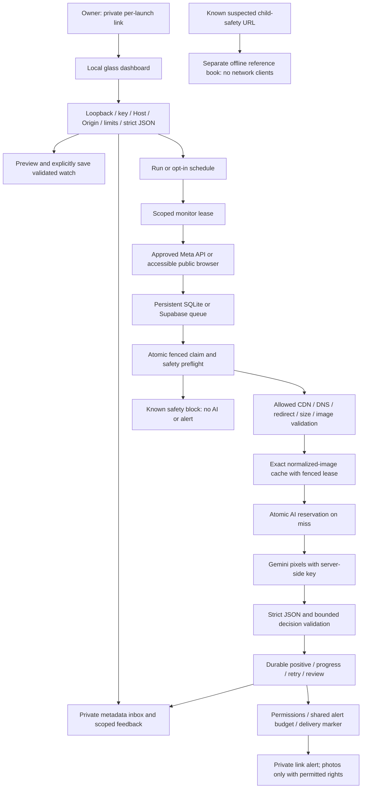

# v8 architecture and security boundary

## Trust boundaries and ownership

The public HTML/CSS/JS are neutral static assets. Private API data is unavailable
without the random per-launch key. JavaScript consumes the key from the URL
fragment and clears it before API requests. Fragments are not sent in HTTP request
URLs; the key is then supplied only in a same-origin header. It is not written to
cookies, localStorage or sessionStorage. A locked page can recover when the owner
pastes the complete private link into that same tab. A reload clears the in-memory
session, so the owner reopens the original link.

The server binds only 127.0.0.1, rejects other Host/Origin values and ambiguous
security/framing headers, caps simultaneous connections at12 with socket timeouts,
and bounds authenticated read/write and failed-auth request rates. Strict bounded
UTF-8 JSON refuses duplicate keys and non-finite values before dispatch. Static
routes are an explicit allowlist, with no project-file serving or arbitrary
filesystem path endpoint. CSP, anti-framing, same-origin resource/opener policy,
no-referrer, no-store and restricted browser capabilities add defense in depth.
These are local safeguards, not an internet-facing authentication/TLS stack.

Secrets remain in server-side environment/configuration and never appear in
snapshots. All generated UI text uses textContent or form values, not HTML
injection sinks. No external fonts, assets or media previews load. A watch must
be previewed before it is saved; a changed watch file invalidates that preview.
Feedback carries the snapshot's target scope and is checked against the current
watch under the save/write lock. Closing the dashboard prevents new runs; active
work retains its existing safe completion behavior. Repeated Start requests do
not restart the schedule continuously.

SQLite transactions and PostgreSQL RPC agree on queue/cache/monitor fencing,
shared budgets, digests and feedback. v8 does not alter the v7 SQL schema.
Provider responses and model JSON are treated as untrusted: duplicate keys,
non-finite numbers, oversized data and incompatible decision shapes fail closed.
A post's known safety block overrides an older positive decision and is checked
again after source refresh before notification. The offline casebook remains
separate from all browser, vision and bot processing.

Telegram has no caller-supplied idempotency key in this integration. A send whose
response cannot be read/parsed reliably remains uncertain and is held for manual
review, including oversized or invalid-length response bodies. A lost response
never justifies a blind resend. Exactly-once external effects are not guaranteed.

## What this protects against

- Unauthenticated local API access that previously obtained a session key.
- Browser cross-origin requests and common DNS-rebinding/CSRF access paths.
- Ambiguous request framing, malformed JSON and unbounded handler creation.
- Literal HTML/script descriptions executing in the rendered UI.
- Stale feedback landing in a different target scope and known stale previews
  overwriting an intervening editor change.
- Known safety-blocked positives being delivered after older classification.
- Ambiguous provider/model decisions or unreadable Telegram success responses
  being mistaken for safe, repeatable deliveries.
- Malformed/foreign-scope queue rows crossing the state boundary.

## Explicit limits

This is a single-device, single-operator tool. It cannot protect against a
compromised operating-system account, root/admin access, malicious privileged
browser extensions, someone using an unlocked authorized browser, or anyone who
obtains the private launch link. Local files are not encrypted. Keep OS accounts,
folder ACLs, extensions, terminal output and credentials private. Loopback HTTP is
not a TLS-protected public service; do not publish/reverse-proxy it or treat it as
multi-tenant hosting. Resource caps reduce work but do not promise denial-of-service
immunity. Other local processes can still compete for machine resources.

The known-caption child-safety guard is best-effort text routing, not a classifier
that can certify unseen media. Use only offline reference reporting for known
suspected exploitation material. Model outputs cannot establish identity, crime,
authenticity, location safety or calibrated probability. No credentials or app
approval were available for live provider verification. Official API approval,
terms, quotas, network trust and actual target performance remain external limits.
